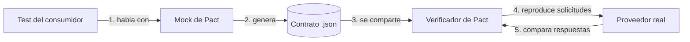

# Contract Testing con Pact

## 1. ¿Qué es una prueba de contrato?
Cuando dos servicios se comunican, entre ellos existe un **contrato**: un acuerdo sobre qué se pide (ruta, parámetros, headers) y qué se responde (código de estado, campos y tipos).

Una **prueba de contrato** comprueba que ambos lados cumplen ese acuerdo, **sin necesidad de levantar los dos servicios juntos**. Cada servicio se prueba por separado contra el contrato.

_¿Por qué no alcanza con otras pruebas?_
- **Pruebas unitarias con mocks:** el consumidor prueba contra un mock que escribió él mismo. Si el proveedor cambia, el mock sigue respondiendo lo viejo y el test sigue pasando.
- **Pruebas end-to-end (de integración):** sí detectan el problema, pero son lentas, frágiles y requieren todo el sistema desplegado. El error aparece tarde.

La prueba de contrato queda en el medio: es rápida como una prueba unitaria, pero detecta incompatibilidades como una de integración.

## 2. Contratos dirigidos por el consumidor
Pact sigue el enfoque **Consumer-Driven Contracts** (contratos dirigidos por el consumidor):
- El **consumidor** escribe lo que necesita del proveedor (solo los campos que realmente usa).
- El **proveedor** debe demostrar que cumple con todo lo que sus consumidores necesitan.

La ventaja es que el proveedor sabe exactamente qué partes de su API están en uso. Puede cambiar libremente lo que nadie consume, y sabe qué cambios rompen a alguien.

## 3. ¿Qué es Pact?
[Pact](https://docs.pact.io/) es una herramienta de código abierto para hacer pruebas de contrato. Tiene librerías para varios lenguajes (Python, Java, JavaScript, Go, etc.), por lo que consumidor y proveedor pueden estar escritos en lenguajes distintos.

### Conceptos clave
| Concepto | Qué es | En nuestro escenario |
|---|---|---|
| Consumidor | Servicio que hace la solicitud | Solicitudes y despacho (M5) |
| Proveedor | Servicio que responde | Ubicación y disponibilidad (M4) |
| Interacción | Un par solicitud/respuesta esperada | "una consulta de conductores cercanos" |
| Pact (contrato) | Archivo JSON con todas las interacciones | Se guarda en la carpeta `pacts/` |
| Estado del proveedor (`given`) | Situación previa que necesita la interacción | "hay un conductor disponible cerca" |
| Matchers | Reglas flexibles: se valida el **tipo/formato**, no el valor exacto | `total` es entero, `tipo_vehiculo` es `AUTO` o `MOTO` |
| Pact Broker | Servidor donde se publican y comparten los contratos | No se usa: el contrato se comparte por la carpeta `pacts/` del repo |

## 4. ¿Cómo funciona Pact?
El proceso tiene dos etapas, una de cada lado:



**Etapa 1: lado consumidor**
1. En el test, el consumidor define la interacción: "si envío esta solicitud, espero esta respuesta".
2. Pact levanta un **proveedor simulado (mock)** que responde exactamente eso.
3. Se ejecuta el código real del consumidor contra el mock. Si el consumidor envía algo distinto a lo declarado, el test falla.
4. Si el test pasa, Pact escribe el **contrato** (archivo `.json`).

**Etapa 2: lado proveedor**
1. El proveedor obtiene el contrato (desde el repo o desde un Pact Broker).
2. Pact **reproduce cada solicitud** del contrato contra el proveedor real.
3. Compara la respuesta real con la esperada, aplicando los matchers.
4. Si algo no coincide (falta un campo, cambió un tipo, otro código de estado), la verificación falla e indica qué y dónde.

### ¿Cómo detecta incompatibilidades antes de integrar o desplegar?
- **Cada lado se prueba por separado**, en su propio pipeline de CI, sin esperar a que el otro esté desplegado.
- El contrato es la "fuente de verdad" compartida: si el proveedor cambia algo que el consumidor usa, **su propia verificación falla** antes de hacer merge.
- Si el consumidor empieza a pedir algo nuevo que el proveedor todavía no ofrece, la verificación del proveedor también falla, mostrando que todavía no se puede desplegar.
- Con un Pact Broker existe el comando `can-i-deploy`, que responde: "¿esta versión de mi servicio es compatible con las versiones que están en producción?". Así se bloquea un despliegue incompatible.

## 5. Ejemplo práctico en nuestro escenario
Para ilustrar el funcionamiento usamos el escenario del README: Solicitudes y despacho pide a Ubicación y disponibilidad los conductores cercanos por REST (`GET /api/v1/conductores/cercanos`, definido en [`disponibilidad.yaml`](../contratos/openapi/disponibilidad.yaml)).

Los fragmentos son ilustrativos (librería `pact-python`). La implementación completa corresponde a las actividades 7 (lado consumidor) y 8 (lado proveedor).

### Paso 1: el consumidor define lo que espera
Fragmento de un test del consumidor:

```python
pact.upon_receiving("una consulta de conductores cercanos")
    .given("hay un conductor disponible cerca")
    .with_request("GET", "/api/v1/conductores/cercanos")
    ...
    .will_respond_with(200)
    .with_body({
        "total": match.int(1),
        "conductores": match.each_like({
            "conductor_id": match.str("C-001"),
            "tipo_vehiculo": match.regex("AUTO", regex="AUTO|MOTO"),
            "distancia_km": match.number(1.8),
            "eta_minutos": match.number(4),
            ...
        }),
    })
```

`match.each_like` indica "una lista donde cada elemento tiene esta forma". Gracias a los matchers, el proveedor puede responder otros valores (por ejemplo `C-777` y `MOTO`) y el contrato se sigue cumpliendo: lo que importa es la **estructura y los tipos**.

### Paso 2: verificar el proveedor
Del lado del proveedor alcanza con indicarle a Pact dónde está el servicio y dónde está el contrato:

```python
Verifier("ubicacion-disponibilidad")
    .add_transport(url="http://localhost:8000")
    .add_source("pacts/")
    .verify()
```

Si el proveedor responde lo acordado, la salida es:

```
Verifying a pact between solicitudes-despacho and ubicacion-disponibilidad
  una consulta de conductores cercanos
     Given hay un conductor disponible cerca
    returns a response which
      has status code 200 (OK)
      includes headers
        "Content-Type" with value "application/json" (OK)
      has a matching body (OK)
1 passed
```

### Paso 3: detectar una incompatibilidad
Supongamos que el equipo del proveedor renombra `eta_minutos` a `tiempo_estimado`. Su código compila y sus pruebas unitarias pasan, pero la verificación de Pact falla **antes de integrar**:

```
      has a matching body (FAILED)
Failures:
1) Verifying a pact between solicitudes-despacho and ubicacion-disponibilidad
   Given hay un conductor disponible cerca - una consulta de conductores cercanos
    1.1) has a matching body
           $.conductores[0] -> Actual map is missing the following keys: eta_minutos
There were 1 pact failures
```

El mensaje dice exactamente qué consumidor se rompe, en qué interacción y qué campo falta. Sin Pact, este error recién aparecería al integrar ambos servicios.

## 6. Pact frente a OpenAPI y .proto
- **OpenAPI / .proto** describen **toda** la API que ofrece el proveedor (lo que _puede_ hacer).
- **Pact** describe **lo que el consumidor realmente usa** y lo verifica contra el proveedor en ejecución.

Son complementarios: OpenAPI/.proto sirven para diseñar y documentar; Pact para asegurar que los cambios no rompan a ningún consumidor. Para gRPC, Pact no trabaja de forma nativa con HTTP/2 y Protobuf, sino mediante el [plugin de Protobuf](https://github.com/pactflow/pact-protobuf-plugin).

## 7. Limitaciones
- Solo prueba lo que el consumidor declaró: si el test del consumidor está incompleto, el contrato también.
- No reemplaza las pruebas funcionales del proveedor (no valida que la lógica de "cercanía" sea correcta, solo la forma de la respuesta).
- Los estados del proveedor (`given`) requieren preparar datos en el proveedor. Para eso se configura un `state_handler` que, por ejemplo, carga un conductor de prueba.
- Para muchos servicios hace falta infraestructura extra (Pact Broker) para compartir contratos y usar `can-i-deploy`.

## Fuentes
- Documentación oficial de Pact: https://docs.pact.io/
- Cómo funciona Pact: https://docs.pact.io/getting_started/how_pact_works
- pact-python: https://github.com/pact-foundation/pact-python
- Martin Fowler, _Contract Test_: https://martinfowler.com/bliki/ContractTest.html
- Can I Deploy: https://docs.pact.io/pact_broker/can_i_deploy
